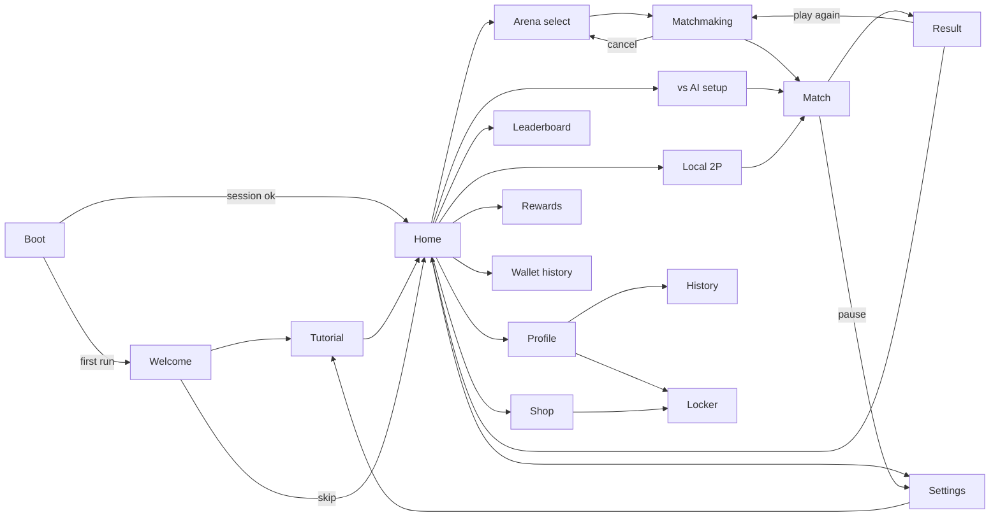

# FlickKick — Screen Inventory

Status: Phase 0 draft, 2026-10-28.

## Part A: Reference evidence (what was actually verified)

### A.1 Sources and their limits

| #   | Source                                                                                           | What I could inspect                                                          | Limits                                                                                                            |
| --- | ------------------------------------------------------------------------------------------------ | ----------------------------------------------------------------------------- | ----------------------------------------------------------------------------------------------------------------- |
| S1  | YouTube `Jtdv-1IxNFo`, "Soccer Stars … IOS Gameplay Video (HD)", 20 min 50 s                     | Title, full description, **126 storyboard frames** (one per 10 s, 390×180 px) | Low resolution. Frames are 10 s apart, so short popups and transitions can be missed. No audio.                   |
| S2  | YouTube `5q6QbFkcWQQ`, "Soccer Stars Football Gameplay Walkthrough (Android & iOS)", 10 min 29 s | Title, description, **127 storyboard frames** (one per 5 s)                   | Same limits                                                                                                       |
| S3  | Aparat `v615p7v`, "بازی ساکر استار پارت چهارم", 2 min 44 s                                       | Title, duration, description only                                             | **Video not inspected visually.** The frames could not be retrieved, so nothing in this inventory is based on S3. |
| S4  | Google Play listing `com.miniclip.soccerstars`                                                   | **Not retrievable** from this environment (the page content did not load)     | Store text was taken from the App Store description embedded in S1 instead                                        |

Reference screenshots are **not** committed to the repository (third-party copyrighted material). The evidence below is cited as video + timestamp.

> If you have more material (your own screenshots or recordings of: Settings, Profile, Shop, Leaderboards, Friends, Team collection, Formations, Daily rewards), please send it. Those screens appear only as nav icons in the frames I could see, so their contents are **not verified**.

### A.2 Verified reference screens

| ID   | Screen                       | Evidence                                          | Observed content                                                                                                                                                                                                                                                                                                                                                                                                                                                                                                       |
| ---- | ---------------------------- | ------------------------------------------------- | ---------------------------------------------------------------------------------------------------------------------------------------------------------------------------------------------------------------------------------------------------------------------------------------------------------------------------------------------------------------------------------------------------------------------------------------------------------------------------------------------------------------------- |
| R-01 | Splash / publisher logo      | S1 0:00                                           | Logo on solid background                                                                                                                                                                                                                                                                                                                                                                                                                                                                                               |
| R-02 | Loading                      | S1 0:10                                           | Game logo over a stylised stadium background, small spinner                                                                                                                                                                                                                                                                                                                                                                                                                                                            |
| R-03 | Tutorial: first shot         | S1 0:20–0:30                                      | Pitch with one disc + ball, instruction banner at top ("score a goal", "hold, adjust aim, release to shoot"), aim arrow, highlighted goal. Second tip on two-finger fine aiming at the edge.                                                                                                                                                                                                                                                                                                                           |
| R-04 | Home / mode select           | S1 20:50                                          | Logo, cards: 1-vs-1 play, live trick-shot competition, minigames, special events; Shop button; pack slots; time-limited offer                                                                                                                                                                                                                                                                                                                                                                                          |
| R-05 | Arena lobby (carousel)       | S1 5:10, 20:20–20:30; S2 0:00–0:05                | Top nav (teams, formations, friends, daily rewards, competitions, free rewards, agents/hire, invite); two currency pills (green notes = premium, coins = soft); horizontally scrolling arena cards (each: name/logo, **prize**, **entry fee**, players online, "2 goals needed to win", info button); savings-jar progress; Shop; 3–4 timed reward-pack slots; time-limited deal banners; event arena with countdown                                                                                                   |
| R-06 | Pre-match "VS" / matchmaking | S1 0:40–0:50; S2 0:10–0:20                        | Arena logo, own card (avatar, name, level badge) vs opponent card (photo or silhouette while searching), **stake pot** in the middle with coin animation, currency pills, back button (cancel), gameplay tip                                                                                                                                                                                                                                                                                                           |
| R-07 | Match scene                  | S1 1:00–20:00; S2 0:25–10:20                      | Landscape pitch, **5 discs per team + 1 ball**, goals on the short sides; top HUD: avatars, names, levels, score each side, pot in centre; bottom-left menu button, bottom-right formation button; banners ("Score 2 goals to win the game!", "X is kicking off", "You are kicking off, good luck!"); active team's discs get a glowing ring; aiming shows a direction arrow plus a dotted pull-back line; quick-chat bubble ("Unlucky"); tooltips "tap to view a profile", "tap to open menu", "use 2 fingers to aim" |
| R-08 | Goal celebration             | S1 20:00; S2 10:00                                | "GOAL!" ribbon across the pitch, confetti; kickoff reset to formation                                                                                                                                                                                                                                                                                                                                                                                                                                                  |
| R-09 | Arena themes                 | S1 (grass, snow/ice), S2 (gold "lightning" arena) | Pitch art and side decorations change per arena; team colours on side banners                                                                                                                                                                                                                                                                                                                                                                                                                                          |
| R-10 | Match result                 | S1 4:40–4:50, 20:00–20:10                         | "Winner" title, both cards, prize amount, "+N Fans" gain, final score, victory-streak counter "6/10 Victories" toward a reward, rank badge, opponent rematch status ("can't play right now"), back                                                                                                                                                                                                                                                                                                                     |
| R-11 | Award toast                  | S1 5:00; S2 3:45                                  | Small toast "You have earned an award: First Win", "New Championship Unlocked!"                                                                                                                                                                                                                                                                                                                                                                                                                                        |
| R-12 | Interstitial ad              | S1 5:00                                           | Full-screen "AD BREAK", text "Any purchase = No ads between matches"                                                                                                                                                                                                                                                                                                                                                                                                                                                   |
| R-13 | Season pass                  | S1 5:20–5:30                                      | Season title + end timer, "collect points to unlock rewards", free track + premium pass track, reward tiles                                                                                                                                                                                                                                                                                                                                                                                                            |
| R-14 | Free rewards popup           | S1 5:40                                           | Coin reward tiers, cooldown "Collect in …"                                                                                                                                                                                                                                                                                                                                                                                                                                                                             |
| R-15 | Inbox / gifts                | S1 5:50                                           | Tabs "Send gifts" / "Inbox", friend gift of coins (accepted), "Invite Friends"                                                                                                                                                                                                                                                                                                                                                                                                                                         |
| R-16 | Pack opening                 | S1 20:40                                          | Card pack reveals "Team Piece ×68" (collectible fragments)                                                                                                                                                                                                                                                                                                                                                                                                                                                             |

### A.3 Verified rules and mechanics (observed, not documented by the publisher)

- 5 discs + 1 ball, top-down landscape pitch, alternating turns, one shot per turn.
- The first player to **2 goals** wins (banner text and arena card). No draw was observed.
- After a goal, all pieces reset to formation and the conceding side kicks off (observed: the player who conceded kicks off next. 2 instances, low confidence).
- Turn ownership is shown by glowing rings on the active side's discs. The frames suggest a turn timer around the avatar, but it can't be confirmed at this resolution.
- Coin stake: the entry fee is deducted at match start (225 → after the match the balance shows the prize) and the winner receives the pot.
- Store text (S1 description): online play, **offline same-device 2-player**, tournaments, friends, collectible teams and cups, optional purchases "includes random items", **weekly VIP subscription**.

### A.4 Not verified (only icons or nothing seen)

Settings, profile detail, leaderboards, friends list, team collection, formation editor, daily-reward calendar, shop contents and prices, login/account linking, language selection, network-error and reconnection screens. **FlickKick designs these screens itself**, and they are not claimed as reference behaviour.

---

## Part B: FlickKick screens (to implement in Phase 1)

FlickKick has its own identity: no copied names, logos, art or text. The structure follows the genre conventions verified above.

Common states for every data screen: **Loading** (skeleton), **Error** (message + Retry, offline hint), **Empty** (illustration + CTA), **Success**.

| ID   | Screen                      | Route                 | Entry → Exit                 | Key components / actions                                                                                                                                                                                                                                  | Data / backend                                               | Ref                        |
| ---- | --------------------------- | --------------------- | ---------------------------- | --------------------------------------------------------------------------------------------------------------------------------------------------------------------------------------------------------------------------------------------------------- | ------------------------------------------------------------ | -------------------------- |
| F-01 | Boot / loading              | `/`                   | app start → F-02 or F-03     | logo, progress, wasm + assets preload, version check                                                                                                                                                                                                      | Rapier wasm, config                                          | R-01/02                    |
| F-02 | Welcome / sign-in           | `/welcome`            | first run → F-04             | Play as guest, sign in / link account, language picker                                                                                                                                                                                                    | `authenticateDevice`, `authenticateEmail`                    | — (own design)             |
| F-03 | Onboarding tutorial         | `/tutorial`           | first run or Settings → F-04 | 3 guided shots in a Phaser scene: select, aim, score                                                                                                                                                                                                      | local only                                                   | R-03                       |
| F-04 | Home                        | `/home`               | main hub                     | Play Online, Play vs AI, Local 2-Player, daily reward, nav bar, currency bar, profile chip                                                                                                                                                                | profile, wallet                                              | R-04                       |
| F-05 | Arena select (online)       | `/play/online`        | F-04 → F-06                  | carousel of arenas: prize, entry fee, level lock, goals to win                                                                                                                                                                                            | config `arenas.json`, wallet                                 | R-05                       |
| F-06 | Matchmaking / VS            | `/play/online/search` | F-05 → F-07; cancel → F-05   | own card, searching opponent card, elapsed timer, "Searching for a player…" → "No player found, starting a match vs a FlickBot" at 15 s; Cancel                                                                                                           | RPC `mm_start`/`mm_cancel`, matchmaker, socket notifications | R-06                       |
| F-07 | Match                       | `/match/:id`          | F-06 / F-08 → F-09           | Phaser scene; HUD (avatars, levels, **BOT badge**, score, pot, turn timer ring), aim/power, pause menu (forfeit, settings), reconnect overlay                                                                                                             | authoritative match socket or local controller               | R-07/08/09                 |
| F-08 | Play vs AI setup            | `/play/ai`            | F-04 → F-07                  | difficulty shown (derived from level) with optional override for unranked practice, team pick                                                                                                                                                             | local                                                        | —                          |
| F-09 | Match result                | `/result/:id`         | F-07 → F-04 / rematch        | winner, score, rewards breakdown (coins, XP), level-up dialog, "bot match" label, Play again                                                                                                                                                              | server result (online) / local                               | R-10                       |
| F-10 | Profile                     | `/profile`            | nav → edit                   | avatar, display name (edit), ID (copy), level + XP bar, stats (played, won, lost, win %, goals), owned cosmetics, account link status, logout                                                                                                             | `profile`, `progress`                                        | —                          |
| F-11 | Match history               | `/profile/history`    | F-10                         | list: date, opponent (human/bot), score, result, rewards; empty state                                                                                                                                                                                     | `history` RPC                                                | —                          |
| F-12 | Leaderboard                 | `/leaderboard`        | nav                          | tabs: Weekly / All-time; own rank pinned                                                                                                                                                                                                                  | Nakama leaderboards                                          | —                          |
| F-13 | Shop                        | `/shop`               | nav / insufficient-funds CTA | tabs: Teams (disc skins), Balls, Arenas, Coins, Offers; item cards with price; purchase confirm dialog; owned/equipped states; sandbox labels                                                                                                             | `shop_catalog`, `shop_purchase`                              | R-04/05 (shop button only) |
| F-14 | Inventory / Locker          | `/locker`             | nav / F-10                   | equip team, ball, avatar                                                                                                                                                                                                                                  | `inventory`                                                  | —                          |
| F-15 | Rewards                     | `/rewards`            | F-04                         | daily reward (7-day track, claim), rewarded-ad bonus (sandbox), level rewards list                                                                                                                                                                        | `daily_claim`, ledger                                        | R-14                       |
| F-16 | Wallet history              | `/wallet`             | currency bar tap             | ledger entries (reason, delta, balance, time)                                                                                                                                                                                                             | `wallet_ledger`                                              | —                          |
| F-17 | Settings                    | `/settings`           | nav / pause menu             | music/SFX volume + mute, language (en/fa), graphics quality, aim sensitivity + aim-assist line, reduced motion, high contrast, notifications (stored), privacy (analytics opt-in), replay tutorial, reset settings (confirm), delete local data (confirm) | localStorage + `settings` storage                            | —                          |
| F-18 | Local 2-player              | `/play/local`         | F-04 → F-07                  | pass-and-play on one device                                                                                                                                                                                                                               | local                                                        | A.3 store text             |
| F-19 | Network / error dialogs     | global                | any                          | offline banner, reconnecting overlay, session expired, version mismatch, server error with retry                                                                                                                                                          | —                                                            | —                          |
| F-20 | Confirmation dialogs        | global                | any                          | purchase, forfeit, cancel search, logout, reset                                                                                                                                                                                                           | —                                                            | —                          |
| F-21 | Dev tools (dev builds only) | `/dev`                | hidden                       | set level/XP, grant test coins, timeout override display, sim hash viewer                                                                                                                                                                                 | dev-only RPCs, disabled in prod                              | —                          |

Season pass (R-13), packs with random contents (R-16), VIP subscription, friends/gifts (R-15) and minigames/events are **not** in Phase 1 unless approved (see PRODUCT_SPEC open questions).

## Part C: Navigation graph

Bottom navigation (mobile) / side rail (desktop): Home · Shop · Leaderboard · Profile · Settings. Every item leads to an implemented screen.
